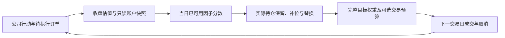

# CLEAR-US 阶段实施与进展报告

报告日期：2026-11-09，香港时间。

## 结论

已完成公开数据到动量、多因子和组合账户的研究闭环；本轮完成基于真实成交持仓的TopK Drop，随后实现下一阶段的执行金额限额及组合风险诊断基础。完整指数增强、机器学习、新闻和IBKR执行尚未完成，当前成果均为本地公开数据探索研究。

TopK Drop在同区间内把多因子组合的累计双边换手降低约66.08%，佣金降低约44.77%；净收益由11.32%变为11.99%，最大回撤由10.19%变为10.21%，不能称为回撤改善。增加执行限额后回撤下降，但平均仓位明显下降，须与信号贡献区分。

## 已完成内容

| 阶段 | 完成内容 | 当前状态 |
|---|---|---|
| 数据基础 | 固定503个股票代码及SPY的缓存；日历、来源哈希、实际获取时间、公司行动检查及普通事件账本 | 可用于带假设的公开研究；严格V1数据资格未通过 |
| 第一步 | 20日动量、组合账户、80% SPY及目标80%等权基准，费用和执行口径统一 | 已完成并保留原结果 |
| 第二步 | 14个传统因子、行业内MAD去极值和标准化、通用SignalScore接口、共同因子池动量对照 | 已完成；全期未证明优于动量 |
| 第三步，本轮 | 每日账户快照、实际成交持仓驱动TopK Drop、0.15标准差换仓门槛、20%常规替换上限 | 已完成并回测 |
| 第四步基础，本轮 | 单日双边交易金额上限、单股历史流动性代理预算、目标权重及主动风险输入诊断 | 基础实现完成；完整指数增强仍未就绪 |
| 后续 | 历史基准权重、风险模型、优化器、完整风控状态机、LightGBM、新闻和IBKR | 待后续完成，不能宣称已上线 |

第一步较早评估期为2024-12-23起；本报告对照沿用第二步共同61日因子池及2025-02-10起的评估期，不混用不同起点的累计收益。

## 本轮第三步：实际账户状态与TopK Drop

新增 `quant_backtest.portfolio.AccountSnapshot`，每天在公司行动、普通成交及收盘估值完成后，向策略提供当天实际现金、有效净值、实际股数、实际权重、回撤和估值状态。持仓映射只读，快照不包含未来行情。`simulate_portfolio(..., strategy=callback)` 是可选接口，旧批量目标接口继续可用，二者不能同时传入。



规则固定于 `configs/dropout_public_v1.json`：

- 保留仍合格、满足行业及发行人目标约束的实际持仓。
- 首次建仓和未成交造成的空位，按分数顺序补足最多20只；未成交目标不视为已经持有。
- 常规替换数最多为 `floor(实际持仓数量 × 20%)`，不足5只时可以为零；补位另计。
- 新股比被替换股至少高出当日合格池分数总体标准差的0.15倍，且必须严格更高；同分不换。
- 资格失效或目标约束冲突造成的退出，与常规分数替换分开记录；这类退出可超过20%数量上限。
- 每次替换都重新检查单股4%、行业20%、同发行人一个股类、最多20只等目标限制。
- 持仓价格或公司行动状态不可靠时跳过调仓。完整目标包含保留持仓，避免遗漏即清仓。
- 每周恢复入选股票4%目标权重，故仍存在保留股票的差额交易；TopK Drop不等于固定金额换手。

审计记录区分 `actual_holdings`、`forced_exits`、`vacancy_buys`、`replacements`，包含实际分数优势和门槛。订单未成交或部分成交后，下次重新读取实际账户，不沿用上次计划股数。

## 完成第三步后推进的第四步基础

在单独的 `DROP-RISK-PUBLIC-1.0.0` 变体中实现：

1. 普通买入与卖出成交金额合计，不超过信号日净值25%。明确采用双边合计，解决原文“净调仓”的歧义；这是研究版本的保守定义。
2. 单股普通成交金额不超过信号时已可用的20日平均 `Close × Volume` 代理的1%。缺少所需历史时预算为零。
3. 以实际加滑点成交价限制整数股数量，先卖后买共用同一预算；未成交余量取消，不追到后来价格。
4. 首次建仓也受25%限额约束，没有初始建仓豁免；仓位可能逐周建立。佣金及机械公司行动金额不计入普通成交金额预算。
5. 输出目标权重风险诊断：单股与行业绝对上限；若提供历史基准、Beta及日协方差，计算主动权重、行业偏离、Beta和预测年化跟踪误差，并报告明显无解的基准权重边界。

真实缓存运行中，91个信号周的两种动态策略目标均无单股及行业绝对目标超限。金额限额变体完成1119项逐日合计／单股实际成交预算检查，记录630次订单缩量或限制。数值以 `comparison.json` 为准。

当前没有历史基准权重与已验收风险输入，`index_risk_readiness.json` 明确为 `not_ready`，不能据缺失数据宣称满足±1.5%单股主动偏离、±3%行业主动偏离、Beta 0.85–1.05及8%跟踪误差。风险诊断器不是组合优化器，也不替代协方差模型质量及半正定性验证。

单股交易容量使用公开代理，不是精确美元成交额，不能当作正式交易容量核验。目标权重限制也不是成交后持续硬限额；价格变动和预算缩量都可能造成实际权重偏离。

## 同口径回测结果

评估期：2025-02-10至2026-11-03，436个交易日；初始10万美元、整数股、每股0.005美元且每笔至少1美元佣金、单边5 bps滑点，采用次日开盘研究代理。没有根据本轮收益修改参数。

| 组合 | 累计净收益 | 年化夏普 | 最大回撤 | 日均股票仓位 | 累计双边换手 | 佣金 |
|---|---:|---:|---:|---:|---:|---:|
| 多因子，无缓冲 | 11.32% | 0.633 | 10.19% | 77.46% | 87.29倍 | $2,594.18 |
| 多因子＋TopK Drop | 11.99% | 0.733 | 10.21% | 77.56% | 29.61倍 | $1,432.66 |
| TopK Drop＋执行限额 | 10.70% | 0.722 | 7.90% | 66.78% | 22.73倍 | $1,029.56 |
| 80% SPY＋现金 | 21.51% | 0.900 | 15.15% | 79.75% | 1.00倍 | $32.00 |

换仓缓冲达到降低换手的工程研究目标，但累计净收益仍未超过SPY。这也不意味着已优于第二步的同池动量；第二步同区间动量净收益为68.72%。

限额变体有9个交易日实际股票仓位低于50%，未加限额的两种多因子组合均无此情形。不能把“目标80%”等同于实际持仓率，也不能凭本次研究统计断言符合官方比赛资格。限额变体较低回撤部分可能来自较低风险敞口，需要后续做仓位匹配实验。

各描述性子区间结果保存在每个组合的 `windows` 字段；均不宣称独立样本外。当前股票池、最新复权历史、模型发布时间、成交额代理、复杂行动历史保护、除息日提前现金等既有研究局限继续存在；模拟开盘成交不重现开盘后5–20分钟的限价执行。

## 验证

- 139项自动测试通过。新增12项覆盖实际持仓替换数、首次建仓、空位补足、资格退出、未知持仓、分数门槛、行业及发行人约束、只读快照、取消成交后的账户反馈、旧批量与动态账户一致、实际成交价限额、卖买共用预算及风险数据缺失。
- 四组回测均独立重建每日现金、股数和净值，核对全部普通成交发生于信号后的下一交易日。
- 无缓冲多因子结果与第二步一致；新增回调及可选预算没有改变旧路径的研究结果。
- 重复完整运行对比净值文件SHA256；最终记录在 `reproducibility.json`，包含源代码及输入指纹。

## 下一阶段实施计划

下一阶段聚焦完整仓位与风险约束，按以下顺序推进；数据等待另计，不直接进入券商交易。

| 顺序 | 工作与交付 | 验收条件 |
|---|---|---|
| 1：风险数据契约，1–2个工作日 | 定义历史基准权重、成分、行业、Beta和协方差输入，含生效时间、可用时间及估计窗口；建立逐日覆盖表 | 权重和价格对应同一证券及交易日；没有历史数据时明确缺口，不以当前权重冒充历史 |
| 2：可行性与约束优先级，1–2个工作日 | 检查4%单股上限与±1.5%主动偏离、20%行业上限与±3%偏离、60%防御仓位与Beta下限的冲突；形成版本化规则 | 构造无解例子能给出原因；不得自动放宽限制或用零替代未知输入 |
| 3：权重优化，2–3个工作日 | 以分数为输入，在绝对权重、主动风险、现金及成本约束下产生完整目标；验证协方差质量、PSD及年化单位 | 无前视；求解失败保留安全已有仓位并记录；整数股与预算后重新报告实际风险 |
| 4：风控状态机，2–3个工作日 | 补充成本与建仓参考价快照；实现文档中的单股减仓、回撤降档、恢复等待和异常规则 | 边界、重复触发、部分成交、公司行动调整及恢复路径可重放；明确对最低仓位的影响 |
| 5：验证与冻结，1–2个工作日 | 仓位匹配对照、成本压力及独立账目检查，冻结进入后续模型阶段的配置 | 比较净收益、回撤、换手和实际仓位；保留失败结果，不从已看区间追称样本外 |

在这些基础完成后再接单LightGBM、状态专家和新闻；IBKR模拟盘独立验收拒单、撤单、部分成交、重连与账户对账。现阶段没有模型训练或券商下单。

## 运行及文件

在项目根目录执行，无需新增依赖或网络：

```bash
python3 -m examples.run_public_dropout
python3 -m unittest discover -s tests -q
```

默认输出 `outputs/public_dropout_20261109/`：

- `comparison.json`、`net_values.csv`：四组结果、子区间及验证摘要。
- `run_protocol.json`、`config_snapshot.json`：首次登记与本轮规则。
- 各组合子目录：订单、成交、持仓、公司行动、净值与调仓。
- 动态策略子目录的 `strategy_audit.json`：真实持仓、补位、退出及换仓原因。
- `execution_limits.json`：成交预算缩量及取消原因。
- `index_risk_readiness.json`：绝对目标检查及完整指数增强缺失输入。

本报告与前两步文档共同构成当前项目进度记录：`公开动量基线与基准回测.md`、`传统多因子评分与接入.md`。
